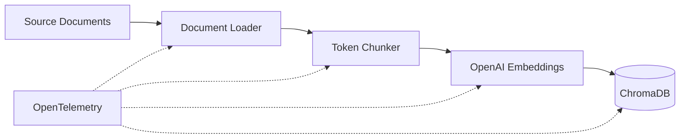
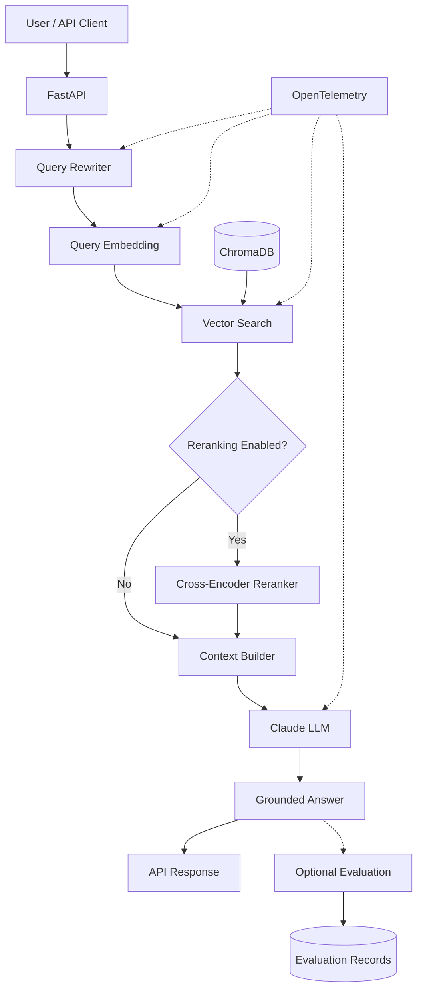
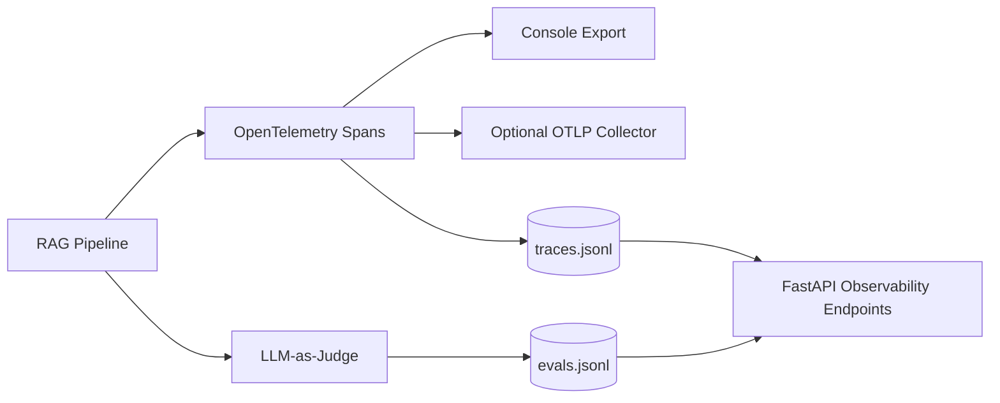

# RAG System — Retrieval-Augmented Generation, Observability & Evaluation


An end-to-end Retrieval-Augmented Generation (RAG) system combining semantic search, document ingestion, grounded LLM generation, OpenTelemetry instrumentation and automated answer evaluation through a FastAPI backend.

Designed to demonstrate practical AI engineering, backend development, vector database integration and production-oriented LLM application architecture.

## Overview

Large language models can generate plausible answers without sufficient supporting evidence. Retrieval-Augmented Generation addresses this limitation by retrieving relevant information from an external knowledge base before generating a response.

This project implements a modular RAG pipeline that processes documents, stores vector embeddings, retrieves relevant passages and generates answers using the retrieved context.

Beyond generation, the system includes observability and evaluation capabilities to help developers understand retrieval behaviour, response quality, latency and token consumption.

## Key Features

### Document Processing

- PDF, Markdown, HTML and plain-text ingestion.
- Raw text and file upload support.
- Token-aware document chunking with configurable overlap.
- Batch embedding generation.
- Persistent vector storage with ChromaDB.
- Source metadata preservation.
- Document deletion and collection management.

### Intelligent Retrieval

- LLM-powered query rewriting.
- Semantic similarity search.
- Configurable top-K retrieval.
- Optional cross-encoder reranking.
- Retrieval metadata and relevance scores.

### Grounded Generation

- Anthropic Claude integration.
- Context-aware prompt construction.
- Source attribution.
- Instructions to abstain when retrieved information is insufficient.
- Streaming responses through Server-Sent Events.
- Token consumption and generation latency reporting.

### Observability

- OpenTelemetry instrumentation across major pipeline operations.
- Console span exporting.
- Optional OTLP trace exporting.
- Local JSONL trace persistence.
- Retrieval and generation diagnostics.
- Aggregate latency and evaluation statistics.

### Automated Evaluation

- Custom LLM-as-judge evaluation engine.
- Faithfulness assessment.
- Answer relevance scoring.
- Context precision estimation.
- Context recall estimation.
- Weighted overall quality score.
- Batch evaluation and persistent evaluation records.

### Backend API

- FastAPI REST interface.
- Pydantic request and response models.
- Interactive OpenAPI documentation.
- Document ingestion and management endpoints.
- Query, streaming and evaluation endpoints.
- Health and observability endpoints.

## System Architecture

### Document Ingestion



The ingestion pipeline converts source documents into smaller text passages, generates embeddings and stores the resulting vectors alongside document metadata.

### Retrieval and Generation



The retriever reformulates the question, embeds it and searches the vector database for relevant passages. The generator combines the original question with the retrieved context before requesting a response from Claude.

### Observability and Evaluation



## Technology Stack

| Technology | Responsibility |
|---|---|
| Python | Core application development |
| FastAPI | REST API and serving layer |
| Pydantic | Request and response validation |
| Uvicorn | ASGI application server |
| OpenAI | Text embedding generation |
| Anthropic Claude | Query rewriting, generation and evaluation |
| ChromaDB | Persistent vector database |
| Sentence Transformers | Optional cross-encoder reranking |
| tiktoken | Token counting |
| PyPDF | PDF text extraction |
| Beautiful Soup | HTML processing |
| markdown-it-py | Markdown processing |
| OpenTelemetry | Pipeline instrumentation |
| OTLP | Optional trace export |
| JSONL | Local trace and evaluation persistence |
| python-dotenv | Environment configuration |

## Getting Started

### Prerequisites

- Python 3.11 or newer.
- Git.
- An OpenAI API key.
- An Anthropic API key.

Python 3.11 is recommended as an initial development environment. Compatibility with additional Python versions has not yet been established through a CI matrix.

API usage may incur charges.

### 1. Clone the Repository

```bash
git clone https://github.com/OfficialBakang/rag-system.git
cd rag-system
```

### 2. Create a Virtual Environment

Windows Command Prompt:

```cmd
py -3.11 -m venv .venv
.venv\Scripts\activate.bat
```

Linux or macOS:

```bash
python3.11 -m venv .venv
source .venv/bin/activate
```

### 3. Install Dependencies

```bash
python -m pip install --upgrade pip
python -m pip install -r requirements.txt
```

### 4. Configure Environment Variables

Create a `.env` file in the repository root.

```dotenv
OPENAI_API_KEY=your_openai_api_key
ANTHROPIC_API_KEY=your_anthropic_api_key

CHUNK_SIZE=400
CHUNK_OVERLAP=80
RETRIEVAL_TOP_K=6
RERANK_TOP_N=3

LLM_MODEL=claude-sonnet-4-5
MAX_TOKENS=1024
EVAL_MODEL=claude-sonnet-4-5

OTEL_ENABLED=false
OTEL_SERVICE_NAME=rag-system

TRACE_LOG_PATH=./data/traces.jsonl
EVAL_LOG_PATH=./data/evals.jsonl
```

Replace the API key placeholders with your credentials.

Configure generation and evaluation models according to their availability in your Anthropic account.

Never commit your `.env` file or real API keys.


Copy the example environment configuration:

### Windows (CMD)

```cmd
copy .env.example .env
```

### Linux / macOS

```bash
cp .env.example .env
```

Open `.env` and provide your OpenAI and Anthropic API keys.

The remaining settings can be adjusted according to your
retrieval, generation, evaluation and observability requirements.

See [.env.example](.env.example) for the available configuration.

Never commit your actual `.env` file.


Before starting the HTTP API, set three separate service keys in your runtime environment or local .env file. Generate each independently with Python and keep terminal output private.

```cmd
python -c "import secrets; print(secrets.token_hex(32))"
```

Assign one key each to RAG_READER_API_KEY, RAG_EDITOR_API_KEY and RAG_ADMIN_API_KEY. Swagger accepts a key through Authorize. Set RAG_PUBLIC_DOCS=false to disable public documentation.

### 5. Run the Live Pipeline Smoke Test (requires provider credentials)

```bash
python test_pipeline.py
```

The script ingests sample documents, performs retrieval, generates an answer and reports source information, token usage and latency.

### 6. Start the API

```bash
python -m uvicorn api:app --no-access-log --no-proxy-headers --reload --host 127.0.0.1 --port 8000
```

The API will be available at:

http://127.0.0.1:8000

### Interactive API Documentation

- Swagger UI: http://127.0.0.1:8000/docs
- ReDoc: http://127.0.0.1:8000/redoc
- OpenAPI schema: http://127.0.0.1:8000/openapi.json

## Docker deployment

Install Docker Desktop in Linux-container mode on Windows, or Docker Engine on Linux,
with Compose v2.24 or later. The first build needs internet access for the Python
base image, runtime packages and tokenizer cache. The host-side smoke script uses
only Python 3.12 and the Docker CLI.

The builder installs runtime dependencies into a virtual environment. The final
Python 3.12 slim image copies that environment and the API source, caches the
`cl100k_base` tokenizer and runs one Uvicorn worker as UID 10001. The build
context allows only runtime source and build inputs. Development tools and the
optional cross-encoder dependencies stay outside the image.

### Run the full RAG service

From the repository root, create a local configuration file if needed (Windows CMD).

```cmd
if not exist .env copy .env.example .env
```

Set the three generated RAG service keys plus `OPENAI_API_KEY` and `ANTHROPIC_API_KEY` in that file and keep
`RAG_SMOKE_TEST_MODE=false`. Compose supplies the values when the container starts.

```cmd
docker compose up --build -d
curl.exe http://127.0.0.1:8000/health
```

Compose binds port 8000 to loopback and mounts the named volume `rag-qdrant-data` at
`/app/data`. Chroma persists in `/app/data/qdrant`, alongside the trace and
evaluation logs in the parent directory. Use `docker compose down` to shut down
and `docker compose up -d` from the same project to recreate the service with
its data. **`docker compose down -v` removes the persistent volume and its data.**

### Run the credential-free Docker smoke test

```cmd
docker build --target runtime -t rag-system:smoke .
python scripts/docker_smoke.py --image rag-system:smoke
```

The runner starts the image with empty provider credentials, disposable random service keys, no published ports
and `--network none`. It probes HTTP over container loopback, checks UID 10001,
runtime dependencies, cached tokenization, writable storage and absence of
`/app/.env`. A separate short-lived writer inserts and queries a synthetic vector
after the API stops. A fresh API container must see the persisted record in the
same disposable volume. The runner cleans up its containers and volume.

Smoke mode starts the real local store. Ingestion, queries (including streaming
and rewriting) and evaluation return HTTP 503. External trace export is disabled.
Provider authentication, model access and answer quality require live integration tests.

| Endpoint | Successful probe | Failure |
|---|---|---|
| `/live` | HTTP 200 while the API is serving | A stopped process cannot respond |
| `/health` | HTTP 200 with only the status field | HTTP 503 if the collection count fails |
| `/ready` | HTTP 200 when the local store works in smoke mode, or the store works and both provider keys are configured after normal startup | HTTP 503 when a required local check fails |
| `/openapi.json` | FastAPI schema in either mode | A startup failure prevents serving the schema |

Readiness reports `mode`, `database_available`, `providers_configured` and
`rag_ready`. Smoke mode always reports `rag_ready: false`. In normal mode,
`rag_ready` reflects local startup and configuration checks only. Health probes
make no provider requests. Credential validity and provider reachability remain
unverified. A database initialisation error fails startup. A later database
failure leaves liveness available for diagnosis.

## API Reference

### Document Ingestion

| Method | Endpoint | Description |
|---|---|---|
| POST | `/ingest/text` | Add raw text to the knowledge base |
| POST | `/ingest/file` | Upload and process a supported document |

### Query and Generation

| Method | Endpoint | Description |
|---|---|---|
| POST | `/query` | Retrieve context and generate an answer |
| POST | `/query/stream` | Stream answer tokens using SSE |

### Evaluation

| Method | Endpoint | Description |
|---|---|---|
| POST | `/evaluate` | Evaluate an answer against supplied context |
| GET | `/evals` | Retrieve recent evaluation records |

### Observability and Health

| Method | Endpoint | Description |
|---|---|---|
| GET | `/health` | Check application health |
| GET | `/metrics` | Retrieve aggregate pipeline statistics |
| GET | `/traces` | Retrieve recent span records |

### Document Management

| Method | Endpoint | Description |
|---|---|---|
| GET | `/sources` | List available document sources |
| DELETE | `/documents/{doc_id}` | Remove chunks belonging to a document |

## API Usage Examples

The examples below use curl with Bash-compatible quoting. Set RAG_API_KEY in your shell to a credential with the required role. Windows users can use the interactive Swagger UI instead.

### Ingest Raw Text

```bash
curl -H "X-API-Key: $RAG_API_KEY" -X POST http://127.0.0.1:8000/ingest/text \
  -H "Content-Type: application/json" \
  -d '{
    "text": "Retrieval-Augmented Generation combines information retrieval with language model generation.",
    "source": "rag-notes.txt"
  }'
```

### Upload a Document

```bash
curl -H "X-API-Key: $RAG_API_KEY" -X POST http://127.0.0.1:8000/ingest/file \
  -F "file=@document.pdf"
```

### Query the Knowledge Base

```bash
curl -H "X-API-Key: $RAG_API_KEY" -X POST http://127.0.0.1:8000/query \
  -H "Content-Type: application/json" \
  -d '{
    "query": "How does retrieval-augmented generation work?",
    "top_k": 4,
    "evaluate": false
  }'
```

The response includes:

- Generated answer.
- Original query.
- Source documents.
- Retrieved passages.
- Retrieval scores and ranks.
- Generation model.
- Prompt and completion token counts.
- Generation latency.
- Trace identifier.
- Optional evaluation results.

### Query With Evaluation

```bash
curl -H "X-API-Key: $RAG_API_KEY" -X POST http://127.0.0.1:8000/query \
  -H "Content-Type: application/json" \
  -d '{
    "query": "What is retrieval-augmented generation?",
    "top_k": 4,
    "evaluate": true
  }'
```

Enabling evaluation performs additional LLM calls and may increase latency and API costs.

### Stream a Response

```bash
curl -H "X-API-Key: $RAG_API_KEY" -N -X POST http://127.0.0.1:8000/query/stream \
  -H "Content-Type: application/json" \
  -d '{
    "query": "Explain RAG architecture.",
    "top_k": 4
  }'
```

### Inspect Pipeline Metrics

```bash
curl -H "X-API-Key: $RAG_API_KEY" http://127.0.0.1:8000/metrics
```

### Inspect Recent Traces

```bash
curl -H "X-API-Key: $RAG_API_KEY" "http://127.0.0.1:8000/traces?limit=10"
```

### Check Application Health

```bash
curl http://127.0.0.1:8000/health
```

## Evaluation Framework

The system implements a custom Claude-based LLM-as-judge evaluator inspired by common RAGAS evaluation dimensions.

Each evaluation dimension receives a score between 0 and 1 together with an explanation from the evaluator.

### Evaluation Metrics

| Metric | Weight | Purpose |
|---|---:|---|
| Faithfulness | 35% | Assesses support for generated claims within retrieved context |
| Answer relevance | 30% | Assesses how well the answer addresses the question |
| Context precision | 20% | Estimates the usefulness of retrieved passages |
| Context recall | 15% | Estimates whether the retrieved information is sufficient |

### Overall Score

The aggregate score combines the four evaluation dimensions:

```text
Overall Score =
    (0.35 × Faithfulness)
  + (0.30 × Answer Relevance)
  + (0.20 × Context Precision)
  + (0.15 × Context Recall)
```

Evaluation records are persisted locally in:

```text
data/evals.jsonl
```

The evaluator supports individual and batch evaluations.

These scores are model-based estimates rather than independently verified accuracy measurements. Context recall is estimated without a dedicated ground-truth reference dataset.

## Observability

OpenTelemetry spans provide visibility into the internal operations of the RAG pipeline.

Instrumented operations include:

| Component | Recorded Information |
|---|---|
| Ingestion | Document and chunk counts |
| Chunking | Token counts and average chunk size |
| Embedding | Model and embedding operations |
| Retrieval | Query rewriting, search and retrieved results |
| Generation | Model, latency and token consumption |
| Evaluation | Evaluation operations |

### Local Trace Persistence

Span records are written to:

```text
data/traces.jsonl
```

Trace records contain information such as:

- Span name and identifiers.
- Parent span information.
- Operation duration.
- Attributes.
- Execution status.
- Timestamp.

Administrators can inspect numeric span attributes and evaluation history. Earlier on-disk records may require separate retention or cleanup.

### Optional OTLP Export

To enable exporting traces to a compatible OpenTelemetry collector, configure:

```dotenv
OTEL_ENABLED=true
OTEL_EXPORTER_OTLP_ENDPOINT=http://localhost:4317
```

A compatible collector must be running separately.

The current local exporter configuration uses an insecure connection and should not be used unchanged for remote production infrastructure.


## Testing and Quality Assurance

The project includes an isolated automated testing suite covering
the core RAG pipeline, FastAPI endpoints, regression scenarios
and application reliability.

### Verification

Local verification on Windows with Python 3.12.10 passed 147 tests with 92.78% statement coverage (including migration importer). Bandit returned zero findings. The new Qdrant runtime audit returned zero known vulnerabilities. The historical Chroma distribution had four distinct advisories. See [SECURITY.md](SECURITY.md) for severity and release impact.

CI requires at least 85% statement coverage across the core package, API, configuration and HTTP security module. The security job and hardened Docker smoke run require their own successful executions after these changes.

### Automated Test Coverage

- Document loading and metadata extraction.
- Token-aware chunking and Unicode boundary handling.
- Embedding batching and retry behaviour.
- Vector similarity search and metadata filtering.
- Query rewriting and optional reranking.
- LLM generation and streaming responses.
- Evaluation scoring and persistence.
- OpenTelemetry instrumentation.
- FastAPI request validation and error handling.
- Idempotent document deletion.
- Secure storage failure responses.
- External network isolation.

### Run Automated Tests

Install the development dependencies:

```bash
python -m pip install -r requirements-dev.txt
```

Prepare the tokenizer cache before running the isolated tests:

```bash
python -c "import tiktoken; tiktoken.get_encoding('cl100k_base')"
```

Execute the automated test suite:

```bash
python -m pytest tests/ -v
```

### Measure Code Coverage

```bash
python -m pytest tests/ --cov=core --cov=api --cov=rag_config --cov=api_security --cov-report=term-missing --cov-report=html --cov-report=xml --cov-fail-under=85
```

Coverage reports are generated at:

- `htmlcov/index.html` — interactive HTML report.
- `coverage.xml` — machine-readable coverage report.

### Code Quality

```bash
python -m ruff check tests/ core/chunker.py core/ingestion_pipeline.py core/telemetry.py core/evals.py core/vector_store.py core/generator.py core/embedder.py core/loader.py core/retriever.py api.py rag_config.py api_security.py scripts/docker_smoke.py
python -m pip check
```

### Test Isolation

External AI provider responses are mocked. Vector searches run
against temporary local ChromaDB collections using synthetic
vectors.

Trace and evaluation records use temporary files. Test setup
disables external telemetry export, dotenv loading and model
downloads while blocking external Python socket operations.

FastAPI requests execute in process without requiring a
deployed application server.

Optional cross-encoder reranking is tested using a controlled
fake model rather than downloading model weights.

### Continuous Integration

The GitHub Actions workflow is configured to execute automated
quality checks on Windows and Ubuntu using Python 3.12.

The configured quality gates include:

- Dependency installation and consistency validation.
- Scoped Ruff linting.
- Automated regression testing.
- Minimum 85% statement coverage.
- Downloadable HTML and XML coverage reports.

A separate Ubuntu job validates Compose, builds the runtime target, reports image
size and runs the isolated Docker smoke script under a 25-minute timeout. It uses
read-only repository permissions and requires no repository secrets. A separate security job runs Bandit, pip-audit and Trivy against source, resolved runtime packages and the built runtime image. Remote Docker
CI verification is pending.

### Live Integration Smoke Tests

The following scripts exercise the real AI integrations and
require valid OpenAI and Anthropic credentials.

| Command | Purpose |
|---|---|
| `python test_pipeline.py` | End-to-end ingestion, retrieval and generation |
| `python test_telemetry.py` | Instrumented retrieval and generation |
| `python test_evals.py` | Live generation and LLM-as-judge evaluation |

Live integration tests may incur API charges and write to the
configured vector database and diagnostic log paths.

Statement coverage measures exercised application code.
It does not measure RAG answer accuracy, retrieval quality
or branch coverage.


## Engineering Decisions

### Modular Pipeline Architecture

Document loading, chunking, embedding, storage, retrieval and generation are separated into dedicated components.

This design improves maintainability and makes individual components easier to replace or extend.

### Persistent Vector Storage

ChromaDB provides local vector persistence without requiring a separately managed database server for development.

### Token-Aware Chunking

The default configuration uses 400-token chunks with an 80-token overlap.

This provides a starting point for balancing passage size with continuity across chunk boundaries.

Optimal chunking parameters depend on the document corpus and should be evaluated empirically.

### Query Rewriting

An LLM reformulates questions before vector retrieval to help produce search-oriented queries.

The effect on retrieval quality should be established through comparative evaluation.

### Optional Reranking

The retrieval component supports an optional cross-encoder stage to refine candidate ordering after vector search.

Reranking is disabled by default.

### Grounded Generation

The generation prompt instructs the model to rely on retrieved passages, identify sources and abstain when context is insufficient.

Prompt-based grounding reduces certain risks but does not guarantee factual correctness.

### Evaluation as a Dedicated Component

The evaluation engine is separated from generation, allowing response quality to be assessed independently of the primary answer-generation step.

### Observability by Design

Pipeline instrumentation is included alongside core application functionality rather than being treated as a separate deployment concern.

This helps identify bottlenecks and inspect system behaviour during development.

## Project Structure

```text
rag-system/
├── core/
│   ├── __init__.py
│   ├── models.py
│   ├── loader.py
│   ├── chunker.py
│   ├── embedder.py
│   ├── vector_store.py
│   ├── retriever.py
│   ├── generator.py
│   ├── ingestion_pipeline.py
│   ├── telemetry.py
│   └── evals.py
│
├── data/
│   ├── chroma/
│   ├── traces.jsonl
│   └── evals.jsonl
│
├── .gitignore
├── SECURITY.md
├── api_security.py
├── rag_config.py
├── api.py
├── requirements.txt
├── test_pipeline.py
├── test_telemetry.py
├── test_evals.py
└── README.md
```

The local data directory contains runtime-generated storage and diagnostic records.

### Component Responsibilities

| Component | Responsibility |
|---|---|
| `models.py` | Shared pipeline data structures |
| `loader.py` | Document parsing and loading |
| `chunker.py` | Token-aware text segmentation |
| `embedder.py` | Text embedding generation |
| `vector_store.py` | Vector persistence and search |
| `retriever.py` | Query transformation and retrieval |
| `generator.py` | Context construction and answer generation |
| `ingestion_pipeline.py` | Document processing orchestration |
| `telemetry.py` | Tracing and span persistence |
| `evals.py` | LLM-based quality evaluation |
| `api.py` | REST endpoints and application lifecycle |
| `api_security.py` | Service authentication, permissions, admission limits and security headers |
| `rag_config.py` | Runtime mode and validated limits |
| `SECURITY.md` | Deployment model, threat model and vulnerability management |

## API security and deployment

Clients present one service credential in the X-API-Key header. Reader, editor and admin roles share a single tenant. The role matrix, threat model, configuration limits, intentional API changes, vulnerability policy and reporting channel are documented in [SECURITY.md](SECURITY.md).

The HTTP boundary authenticates and charges a monotonic, process-local budget before passing bounded request bytes to FastAPI. Protected routes enforce role permissions and AI requests hold a concurrency slot until the response or stream finishes. Uploads use a temporary server-owned directory. Validated text enters the existing chunking, embedding and storage pipeline. The model receives retrieved text as untrusted evidence and has no privileged tools. Traces retain numeric measurements and evaluation history retains scores and identifiers.

## Current Limitations

- External API credentials are required for the full pipeline.
- Model-based evaluations are not equivalent to ground-truth benchmarks.
- Embedding and LLM requests introduce external service dependencies.
- Role keys grant corpus-wide access. Individual identities and per-document isolation require additional controls.
- Several API operations use synchronous underlying processing.
- Distributed worker execution has not been established.
- A dedicated frontend dashboard is not included in the public repository.
- Production-scale load and reliability testing have not been verified.

## Development Roadmap

### Implemented

- [x] Document ingestion.
- [x] Token-aware chunking.
- [x] OpenAI embedding integration.
- [x] ChromaDB vector storage.
- [x] Semantic retrieval.
- [x] Query rewriting.
- [x] Optional reranking.
- [x] Grounded Claude generation.
- [x] OpenTelemetry instrumentation.
- [x] Custom evaluation framework.
- [x] FastAPI backend.
- [x] Streaming responses.
- [x] Health and observability endpoints.
- [x] Credential-free automated tests with mocked AI providers.

### Planned Improvements

- [ ] Reproducible dependency locking.
- [ ] Per-user identity and document-level access controls.
- [ ] Asynchronous pipeline processing.
- [ ] Hybrid keyword and semantic search.
- [ ] Ground-truth evaluation datasets.
- [ ] Retrieval and latency benchmarks.
- [ ] Prompt injection resistance testing.
- [ ] React observability dashboard.
- [ ] Cloud deployment and production monitoring.

## Contributing

Contributions, bug reports and technical suggestions are welcome.

1. Fork the repository.
2. Create a feature branch.
3. Implement and validate your changes.
4. Update relevant documentation.
5. Submit a pull request.

## Author

**Bakang Mabilo**

Software Developer | AI Engineering | Full-Stack Development

BEngTech Electrical & Electronics Engineering — University of Johannesburg

[](https://github.com/OfficialBakang)
[](https://www.linkedin.com/in/oratile-mabilo/)

---

Exploring reliable AI systems through retrieval, grounded generation, observability and systematic evaluation.


## Qdrant compatibility prototype

The runtime now uses qdrant-client 1.20.0 through the existing VectorStore methods.
A single process owns trusted persistent storage under QDRANT_PERSIST_DIR.
QDRANT_COLLECTION is deployment-controlled. Each operation is serialised with
a reentrant lock. The first valid nonempty insertion establishes vector dimension.
Every batch is validated before insertion. Cosine vectors are normalised by Qdrant,
so compare direction and scores with tolerance 1e-5. Tied scores can change order.

The separate Compose volume rag-qdrant-data protects the legacy volume during
prototype testing. A legacy chroma.sqlite3 at the requested path is rejected.
Default startup also rejects a detected legacy store when no new Qdrant store exists.
Explicitly configured fresh paths support synthetic rehearsals.

Metadata remains nested separately from chunk identity. Filters support one field
per expression, scalar equality, $eq, $ne, numeric $gt/$gte/$lt/$lte, $in/$nin and
nested $and/$or. Unsupported syntax raises an error. Field names use letters,
numbers, underscore and hyphen.

See docs/adr-qdrant.md for the decision, migration procedure and release gates.

Measured prototype performance is recorded in docs/benchmark-results.md.
